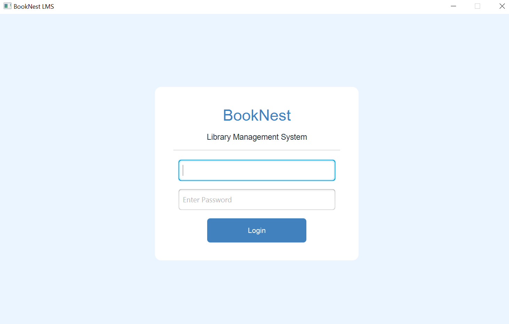
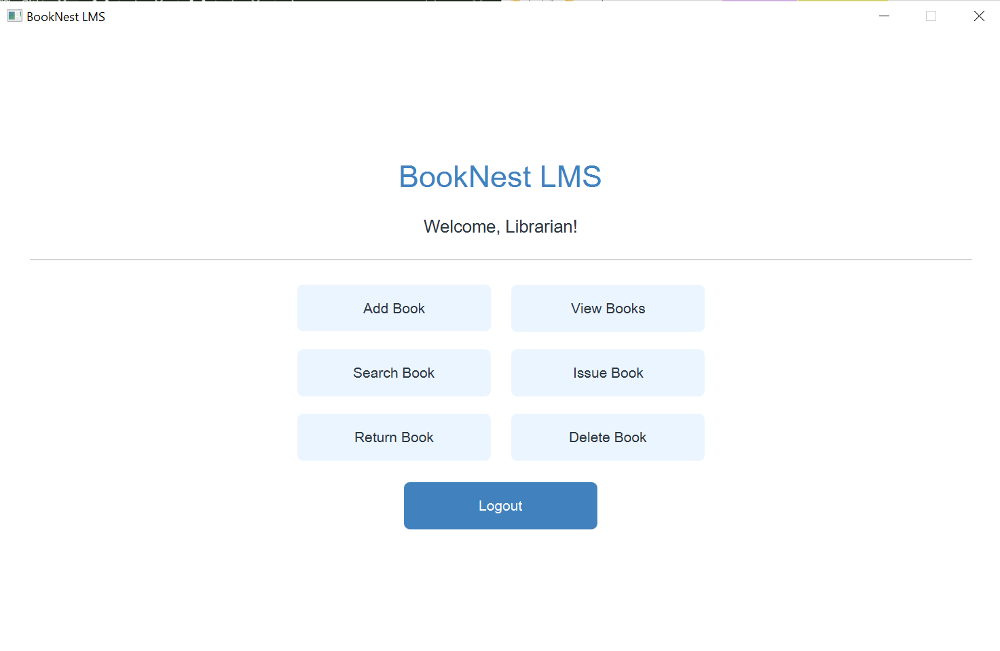
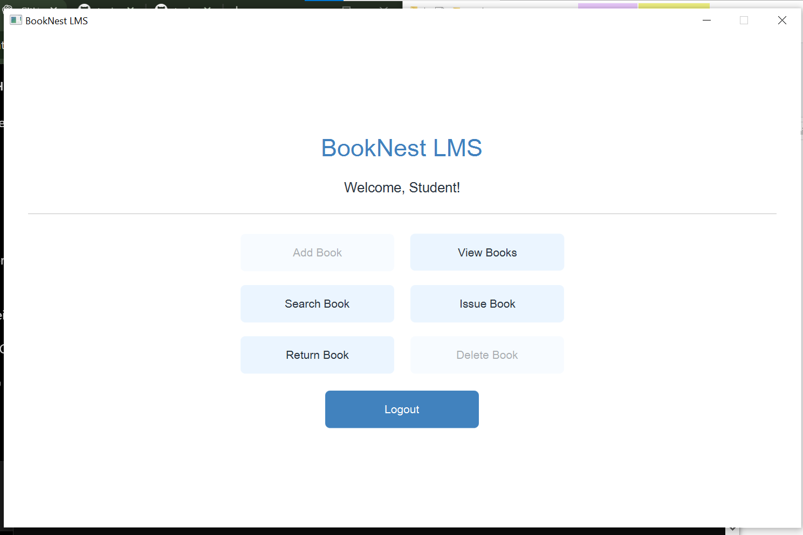

# 📚 BookNest – Library Management System

A simple and user-friendly Library Management System developed using **Java and JavaFX**.

## 👩‍💻 About the Project

BookNest is a desktop-based Library Management System designed to manage library activities digitally. It helps librarians and students perform basic library operations easily.

## ✨ Features

- User Login
- Librarian Dashboard
- Student Dashboard
- Add New Books
- View All Books
- Search Books
- Issue Books
- Return Books
- Delete Books
- Late Return Fine Calculation
- File Handling for Data Storage

## 🖥️ Project Screenshots

### 1. Login Page

### 2. Librarian Dashboard

### 3. Student Dashboard

## 🛠️ Technologies Used

- Java
- JavaFX
- Object-Oriented Programming (OOP)
- File Handling

## 📖 OOP Concepts Used

- Encapsulation
- Inheritance
- Abstraction
- Polymorphism

## 📂 Project Files

- `Main.java` – Main application and program logic
- `UI.java` – User interface
- `Book.java` – Book class and book details
- `User.java` – User classes and roles

## 👩‍🎓 Developed By

**Tanishka Bharti**

## 🎓 Project Type

Academic Java Project
